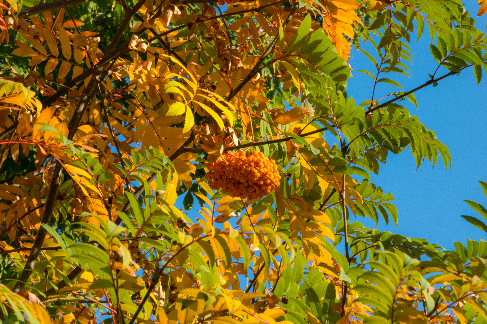
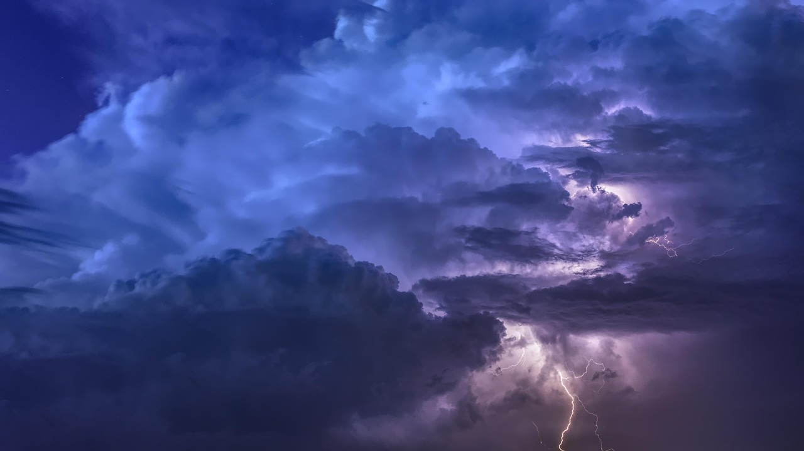

# Daily Wallpaper Storage

## 1. Bing Wallpaper (`bing.jpg`)

* **Заголовок:** Architektur ohne Architekten
* **Описание:** North Window, Arches-Nationalpark, Moab, Utah, USA (© lightphoto/Getty Images)
* **Дата:** 12 November 2026

---
## 2. Unsplash (`unsplash.jpg`)

* **Описание:** A window looking out onto autumn trees with orange and green leaves
* **Дата:** 12 November 2026
* **Автор:** [Clay Banks](https://unsplash.com/@claybanks)

---
## 3. Wallhaven (`wallhaven.jpg`)

* **Заголовок:** [Wallhaven Wallpaper #w5w6zr](https://wallhaven.cc/w/w5w6zr)
* **Разрешение:** 7326x4884
* **Дата:** 12 November 2026

---
## 5. Pixabay (`pixabay.jpg`)

* **Заголовок:** Thunderstorm, lightning, hd wallpaper, sky background, wallpaper hd, mac wallpaper, windows wallpaper, beautiful wallpaper, nature wallpaper, storm, beautiful nature, night, weather, nature background, sky, 4k wallpaper 1920x1080, night sky, desktop backgrounds, 4k wallpaper, clouds, full hd wallpaper, wallpaper 4k, nature, storm clouds, cool backgrounds, free wallpaper, free background, laptop wallpaper, wallpaper, background
* **Разрешение:** 6000x3375
* **Источник:** [https://pixabay.com/photos/thunderstorm-lightning-storm-night-3441687/](https://pixabay.com/photos/thunderstorm-lightning-storm-night-3441687/)
* **Автор:** [Felix-Mittermeier](https://pixabay.com/photos/thunderstorm-lightning-storm-night-3441687/)
* **Дата:** 12 November 2026
